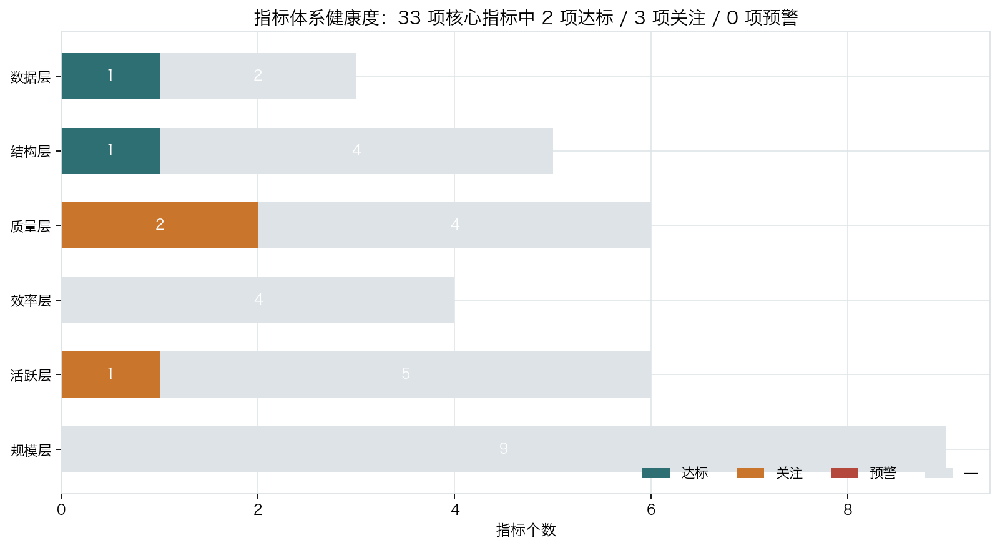
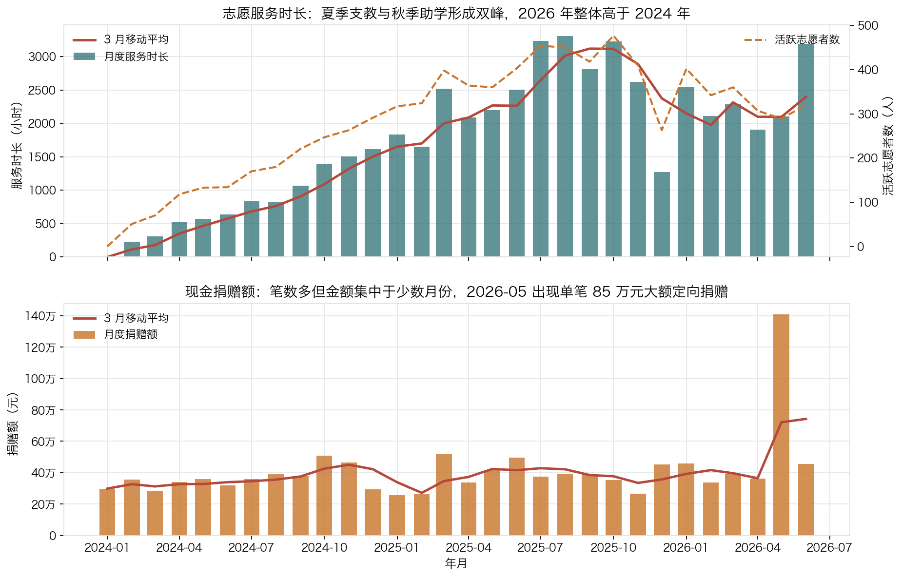
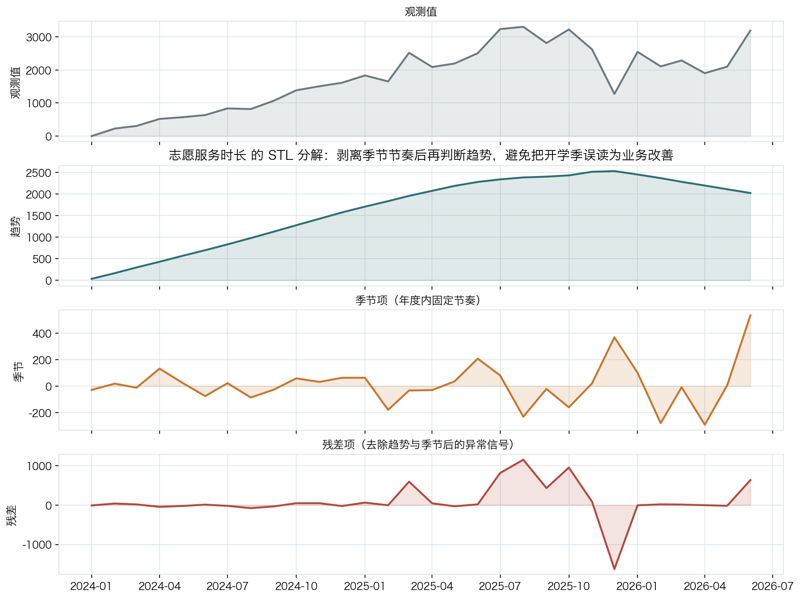
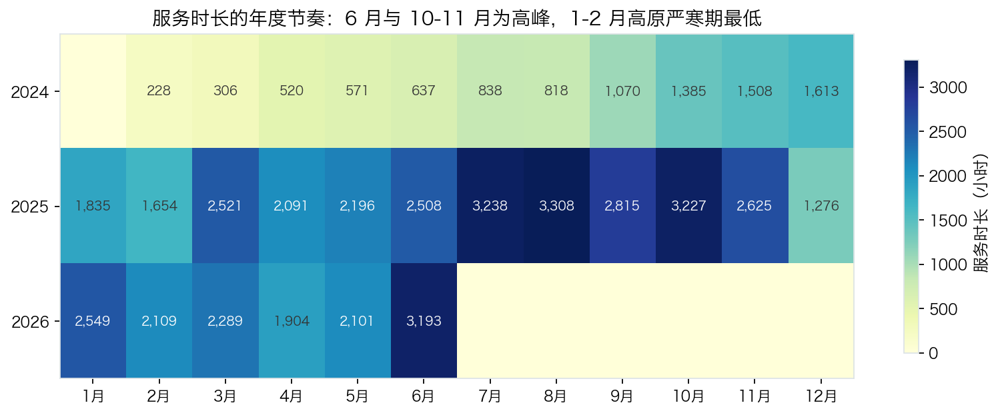
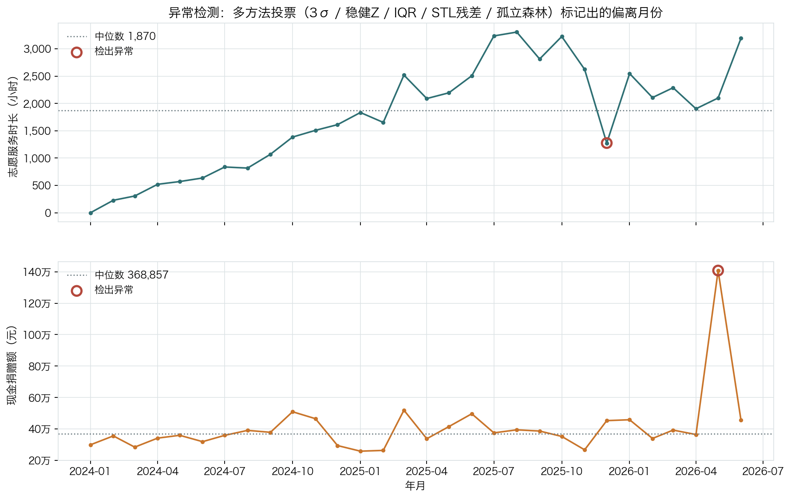
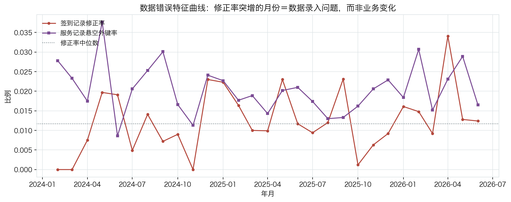
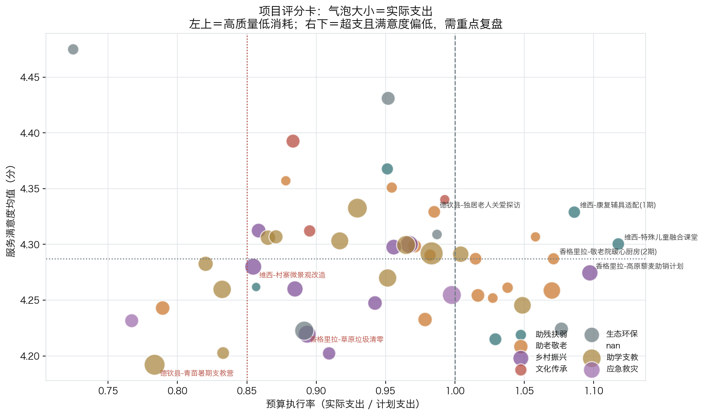
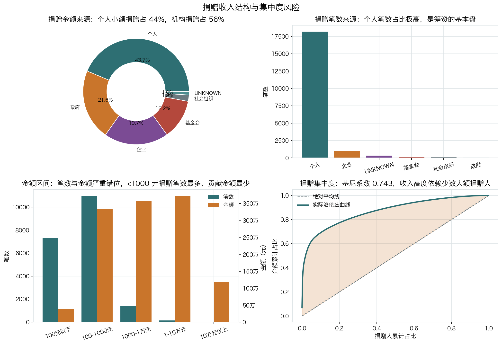
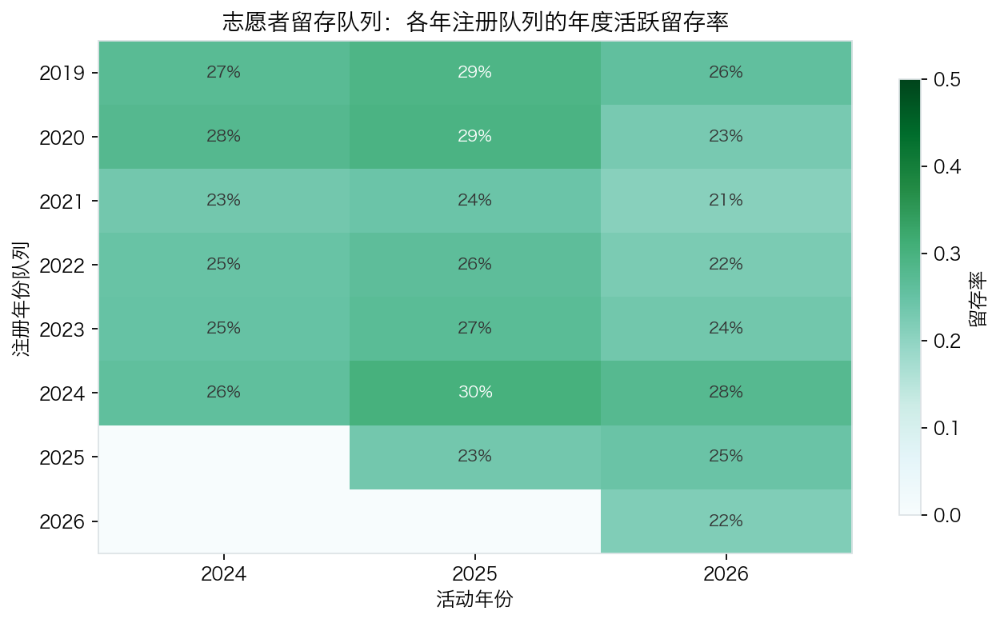
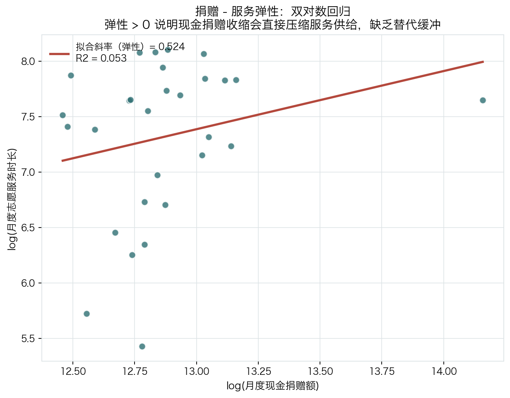

<div align="center">

# 迪庆清风青年公益联合会 · 公益项目数据运营分析

**从多源脏数据到可执行运营决策的完整数据管道**

[](../../actions/workflows/ci.yml)
[](https://www.python.org/)
[](https://github.com/astral-sh/ruff)
[](LICENSE)
[](#-质量保障)
[](reports/sql_verification.log)

[项目背景](#-项目背景) ·
[快速开始](#-快速开始) ·
[分析方法](#-分析方法) ·
[主要发现](#-主要发现) ·
[工程实践](#-工程实践) ·
[局限](#-方法与局限)

</div>

---

## 📌 项目背景

[迪庆藏族自治州](https://diqing.gov.cn/dqgk/rkhmz.html)位于云南西北部，常住人口 39.5 万，
少数民族占比 89.5%，2025 年农村居民人均可支配收入仅 15,640 元。
在这样的地区做公益，**每一份资源都必须花在刀刃上**，而基层公益组织的普遍短板恰恰是数据能力：

- 数据散落在**项目组 Excel、签到小程序、财务月报、捐赠平台、纸质走访表、问卷星**六七个来源里；
- 字段口径不统一（"香格里拉"/"香格里拉市"/"香格里拉 "是三个值）、单位混用（分钟被当小时录入）、
  重复录入普遍存在；
- 有数据但没有**指标体系**，说不清"服务效率是升了还是降了"；
- 有异常但没有**归因方法**，分不清"业务真的出问题了"还是"数据录错了"。

本项目用一条**可复现、可验证**的数据管道回答这些问题：从多源异构原始数据出发，
经过清洗、校验、星型建模、指标体系、趋势与交叉分析、异常检测与归因，
最终产出一份能直接支撑资源配置决策的分析报告。

> ⚠️ **数据性质**：机构内部业务数据无法公开，因此本项目使用**带固定随机种子的模拟数据**。
> 业务分布依据公开统计口径校准（见 [`data/external/calibration_reference.md`](data/external/calibration_reference.md)），
> 所有姓名、电话、档案均为程序生成的虚构信息，**不代表任何真实个人或机构的运营状况**。

---

## ✨ 亮点速览

| # | 亮点 | 说明 |
|---|---|---|
| 1 | **端到端可复现** | 一条 `make pipeline` 从零构建到出报告，全程 30 秒内完成；固定种子下**逐字节可复现**（有测试守护） |
| 2 | **清洗效果可量化** | 生成器刻意注入 **23,361 处**数据缺陷并记录 ground truth，清洗模块的效果可以用**修复率**打分，而不是"看着挺干净" |
| 3 | **异常检测可验证** | 6 个真实异常被植入数据，检测流程给出 **5/6 检出率**，并对漏报给出**量化归因**（信噪比不足） |
| 4 | **完整的星型模型** | 6 维度 + 5 事实的 Kimball 星型模型，含 `-1` UNKNOWN 成员约定，装入 SQLite 并配 **44 条经过执行验证的 SQL** |
| 5 | **五层指标体系** | 规模 / 活跃 / 效率 / 质量 / 结构 + 数据质量共 **33 个 KPI**，每个指标都有口径公式、阈值与状态判定 |
| 6 | **两路异常检测** | 事实表统计异常（业务事件）+ 原始 vs 清洗后的质量特征异常（数据错误），解决"被清洗修掉的异常看不见"的问题 |
| 7 | **严格的工程规范** | 类型化配置、声明式校验规则引擎、**132 个 pytest 用例**、ruff、GitHub Actions CI、Makefile 统一入口 |
| 8 | **诚实的局限声明** | 明确列出模拟数据的边界、因果推断的缺失、异常检测的漏报机制 |

---

## 🚀 快速开始

```bash
# 1) 获取代码
git clone https://github.com/<your-name>/qingfeng-nonprofit-data-analysis.git
cd qingfeng-nonprofit-data-analysis

# 2) 安装依赖（Python >= 3.10）
make setup

# 3) 一条命令跑通全流程：生成数据 -> 清洗 -> 校验 -> 建模 -> 建库 -> 分析 -> 报告
make pipeline

# 4) 查看产出
open reports/dashboard.html          # 可视化仪表盘
open reports/数据分析报告.md          # 主报告
make verify                          # 产物体检
make test                            # 运行测试
```

运行结束后会打印各阶段耗时：

```
=====================================================
阶段                            耗时(s)   状态
-----------------------------------------------------
1/10 生成模拟多源数据                21.44   ok
2/10 多源数据接入与清单对账             0.05   ok
3/10 数据清洗与标准化                 3.08   ok
4/10 数据质量校验                    0.21   ok
5/10 构建星型模型                    1.94   ok
6/10 装入 SQLite 数据仓库            1.33   ok
7/10 计算核心指标体系                 0.38   ok
8/10 描述性统计 / 交叉 / 趋势 / 队列分析  1.02   ok
9/10 异常检测与归因                  9.86   ok
10/11 生成可视化图表                   5.44   ok
11/11 生成分析报告与数据字典            2.11   ok
=====================================================
```

### 分步执行（调试用）

```bash
make data        # 只生成模拟原始数据
make no-regen    # 复用已有原始数据，只跑下游（快得多）
make fast        # 跳过图表生成的完整流程
make sql-all     # 执行全部 SQL 查询并打印结果
make docs        # 从实际产物重新导出数据字典
make notebook    # 启动 Jupyter Lab 浏览 notebooks/
```

---

## 📂 仓库结构

```
qingfeng-nonprofit-data-analysis/
├── README.md                       # 本文件
├── Makefile                        # 统一入口（make help 查看全部目标）
├── pyproject.toml                  # 包定义 / 依赖 / pytest / ruff 配置
├── requirements.txt
│
├── config/
│   └── config.yaml                 # 唯一配置源：路径、模拟参数、质量缺陷比例、分析阈值、配色
│
├── src/qingfeng/                   # 分析工具包（可 pip install -e .）
│   ├── config.py                   # 类型化配置加载（frozen dataclass + 绝对路径解析）
│   ├── tables.py                   # 表规格登记表（主键/业务键/受控词表）——单一事实来源
│   ├── logging_utils.py            # 结构化日志 + 阶段计时器
│   ├── ingest.py                   # 多源异构建入
│   ├── clean.py                    # 清洗与标准化（7 类缺陷处理 + 跨表反推修复）
│   ├── validate.py                 # 声明式数据质量规则引擎
│   ├── transform.py                # 星型模型构建
│   ├── warehouse.py                # SQLite 仓库接入层
│   ├── metrics.py                  # 33 个核心指标
│   ├── analyze.py                  # 描述统计 / 卡方交叉 / STL 趋势 / 队列 / 集中度
│   ├── anomaly.py                  # 五方法投票异常检测 + 归因 + 漏报量化
│   ├── viz.py                      # 14 张业务图表
│   ├── report.py                   # Markdown 报告 + 一页纸摘要 + HTML 仪表盘
│   ├── pipeline.py                 # 端到端编排 + 产物体检
│   └── cli.py                      # 命令行入口
│
├── scripts/
│   ├── generate_synthetic_data.py  # 多源模拟数据生成器（含缺陷注入与 ground truth）
│   ├── verify_sql.py               # 逐条执行 sql/ 并产出验证日志
│   └── build_docs.py               # 从实际产物导出数据字典
│
├── sql/                            # 数据仓库 SQL 层
│   ├── 01_schema.sql               # 星型模型 DDL + 索引
│   ├── 02_load_views.sql           # 5 个分析视图
│   ├── 03_kpi_queries.sql          # KPI 查询集
│   └── 04_analysis_queries.sql     # 趋势/交叉/归因/留存查询集
│
├── data/
│   ├── raw/                        # ① 多源原始数据（含刻意注入的缺陷）
│   │   └── _ground_truth/          #    注入缺陷清单 + 植入异常清单（用于验证）
│   ├── interim/                    # ② 清洗后的中间结果（gitignored）
│   ├── processed/                  # ③ 星型模型 + 全部分析结果 + SQLite 仓库
│   └── external/                   # ④ 公开统计口径与校准依据
│
├── notebooks/                      # 4 份已执行的分析笔记本（含完整输出）
├── reports/
│   ├── 数据分析报告.md              # 主报告（419 行）
│   ├── executive_summary.md        # 一页纸结论摘要
│   ├── dashboard.html              # 单文件 HTML 仪表盘（图片内嵌，可离线打开）
│   ├── kpi_catalog.csv             # 指标字典（口径公式 + 数据来源）
│   ├── sql_verification.log        # 44 条 SQL 的执行验证日志
│   ├── run_manifest.json           # 本次运行的元信息（种子、耗时、告警）
│   └── figures/                    # 33 张图表（14 张管道自动生成 + 19 张 notebook 生成）
├── tests/                          # 132 个测试用例
└── docs/data_dictionary.md         # 自动生成的数据字典
```

---

## 🗂 数据说明

### 多源异构模拟数据

模拟了一家州域青年公益组织的**七类数据源、11 张表、72,898 行**明细：

| 数据表 | 来源系统 | 粒度 | 行数 |
|---|---|---|---|
| `projects` | 项目组 Excel 台账 | 一行 = 一个在册公益项目 | 54 |
| `staff` | 机构人事花名册 | 一行 = 一名工作人员 | 14 |
| `volunteers` | 志愿服务信息系统导出 | 一行 = 一名注册志愿者 | 3,762 |
| `volunteer_shifts` | 签到小程序 + 纸质签到表补录 | 一行 = 一次志愿服务 | 13,492 |
| `donors` | 捐赠平台 + 财务台账 | 一行 = 一个捐赠人 | 5,434 |
| `donations` | 捐赠平台 + 银行流水 | 一行 = 一笔现金捐赠 | 21,370 |
| `in_kind_donations` | 仓库入库单（纸质转录） | 一行 = 一笔物资入库 | 648 |
| `beneficiaries` | 社工入户走访登记表 | 一行 = 一名建档服务对象 | 5,434 |
| `beneficiary_services` | 服务工单系统 + 社工台账 | 一行 = 对一名对象的一次服务 | 17,181 |
| `monthly_budget_execution` | 财务月度报表 | 一行 = 项目 × 月份 × 预算科目 | 3,994 |
| `satisfaction_survey_raw` | 问卷星导出 | 一行 = 一份问卷回复 | 1,515 |

### 公开统计口径校准

模拟数据的**量级、结构与分布**依据公开统计校准，而非拍脑袋（完整来源见
[`data/external/calibration_reference.md`](data/external/calibration_reference.md)）：

| 校准项 | 公开数值 | 用途 |
|---|---|---|
| 迪庆州常住人口 39.5 万，少数民族 89.5% | [迪庆州人民政府](https://diqing.gov.cn/dqgk/rkhmz.html) | 志愿者民族结构、县域项目分布的先验 |
| 藏族 36.3% / 傈僳族 30.2% / 纳西族 12.5% | 同上 | 姓名生成、民族交叉分析 |
| 全国活跃志愿者占比 **28.72%** | [《慈善蓝皮书(2025)》](http://www.gongyishibao.com/html/yanjiubaogao/2026/03/32719.html) | 志愿者活跃率的建模目标与 KPI 预警线 |
| 全国志愿服务贡献价值 2,371 亿元 ÷ 7,704 万活跃志愿者 = 3,078 元/人·年 | 同上 | 反推志愿服务时间折算率 **≈30 元/小时** |
| 2024 年全国社会捐赠 **−8.70%**，志愿服务贡献价值 **+32.38%** | 同上 | 设定"捐赠收缩、志愿时长能否补位"这一核心分析命题 |

### 刻意注入的数据缺陷

生成器按 `config.yaml: data_quality` 的比例注入真实世界常见的七类缺陷，
并把每一处缺陷记录到 `data/raw/_ground_truth/injected_defects.csv`：

| 缺陷类型 | 注入数量 | 清洗策略 |
|---|---:|---|
| 空白 / 全角字符 | 8,038 | NFKC 归一化 + 去空白 + 统一分隔符 |
| 字段缺失 | 6,298 | 维度回填 `UNKNOWN`；度量缺失剔除并留痕 |
| 日期格式混乱 | 3,573 | 六种格式逐一解析（含 `2026年1月5日`） |
| 重复记录 | 3,122 | 主键 + 业务组合键双层去重 |
| 极端 / 越界值 | 1,006 | 按业务物理边界截断或置缺（**保留原值列**供审计） |
| 数值单位混用 | 962 | 正则解析 `3.5h` / `210min` / `4.37 小时` 并统一 |
| 悬空外键 | 362 | 归入 `UNKNOWN` 维度成员，业务量不被静默丢弃 |
| **合计** | **23,361** | |

**这一步是整个项目可验证性的基础**：没有 ground truth，清洗代码写得再漂亮也无法证明它有效。

---

## 🔬 分析方法

### 1. 清洗与跨表修复

除了单表清洗，管道还会做**跨表反推修复**——这是单表视角做不到的：

- 志愿者注册日期缺失 → 用其**最早服务日期**回填；
- 服务对象建档日期缺失 → 用最早服务日期回填，仍缺则用**项目计划开始日**兜底；
- 捐赠人首次捐赠日期缺失 → 用**捐赠流水最早日期**回填；
- 服务记录的县域缺失 → 由**服务对象档案**回填；签到记录的县域缺失 → 由**项目台账**回填。

同时保留修复痕迹：事实表带 `is_corrected` / `has_orphan_key` 标记，且**原始值另立一列**
（`hours_raw` / `amount_raw` / `quantity_raw`），任何修正都可追溯、可回滚。

### 2. 声明式校验规则引擎

`validate.py` 用 **75 条声明式规则**覆盖主键唯一性、受控词表、数值区间、正则格式、
引用完整性、日期先后关系、跨字段业务一致性（如"服务日期不得早于建档日期"）、
整表填充率。规则分 ERROR / WARN / INFO 三级，**ERROR 级失败会阻断 CI**。

### 3. Kimball 星型模型

```
dim_date ──┐
dim_project ──┤
dim_volunteer ──┼──> fact_volunteer_service      (志愿服务签到)
dim_geography ──┤
                ├──> fact_donation               (现金捐赠)
                ├──> fact_in_kind                (物资捐赠)
                ├──> fact_beneficiary_service    (服务提供)
                └──> fact_project_monthly        (月度预算执行)
```

- 每张维度表保留键值 `-1` 的 **UNKNOWN 成员**，承载源系统缺失/悬空的维度引用
  （例如 30% 的非定向捐赠没有归属项目，若直接丢弃会低估筹资总额）；
- 事实表同时保留代理键与业务主键（退化维度），便于回溯原始单据；
- 装入 SQLite 并建立 **19 个显式索引 + 46 条由 DDL 脚本补充的索引**。

### 4. 五层指标体系

| 层级 | 代表指标 | 数量 |
|---|---|---:|
| 规模层 | 项目数、注册志愿者数、服务总时长、捐赠总额、受益对象数 | 9 |
| 活跃层 | 活跃志愿者率、人均服务次数/时长、复访率、一年留存率 | 6 |
| 效率层 | 单位服务成本、每小时服务成本、每万元捐赠撬动服务时长 | 4 |
| 质量层 | 满意度均值/达标率、预算执行率、按期结项率、时长中位数 | 6 |
| 结构层 | 捐赠集中度 HHI、机构捐赠占比、帕累托集中度、双语志愿者占比 | 5 |
| 数据层 | 数据完整性、修正记录率、悬空外键率 | 3 |

每个指标都带**口径公式**与**数据来源表**（导出为 `reports/kpi_catalog.csv`），
并按 `config.yaml` 的阈值判定「达标 / 关注 / 预警」。

### 5. 趋势与交叉分析

- **STL 分解**：公益服务有强季节节奏（6 月暑期支教、10-11 月秋季助学、1-2 月高原严寒期触底），
  不剥离季节成分就直接看环比，会把开学季的正常回落误判为业务恶化；
- **卡方检验 + Cramér's V**：只看 p 值会被大样本误导（n > 1 万时极小差异也显著），
  必须同时看效应量；
- **队列留存**：注册年份 × 活动年份的留存矩阵；
- **双对数弹性回归**：量化"现金捐赠 → 志愿服务时长"的联动强度。

### 6. 两路异常检测

单一方法容易假阳性，因此采用**五方法投票**（≥2 票才判定为异常）：

| 方法 | 作用 |
|---|---|
| 3σ 准则 | 经典但受重尾分布影响 |
| 稳健 Z 分数（MAD） | 抗离群点，基线被污染时仍可用 |
| Tukey 箱线（IQR） | 非参数，对偏态稳健 |
| STL 残差 | 先剥离趋势与季节再看残差 |
| 孤立森林 | 多变量（水平 + 环比 + 同比 + 波动）联合判定 |

关键设计：**两路检测**。被清洗修复掉的异常（如"分钟当小时"、"整表重复导入"）
在清洗后的数据里是看不见的，因此额外对比**原始数据与清洗后数据**，
用「修正率 / 剔除率」的异常抬升来识别**数据录入错误**。
归因阶段据此区分「业务事件」与「数据错误」——这正是数据运营岗最核心的判断。

---

## 📊 主要发现

> 以下数字全部由管道自动计算并写入 [`reports/数据分析报告.md`](reports/数据分析报告.md)，
> 无任何硬编码。

### 规模与活跃

| 指标 | 数值 | 解读 |
|---|---|---|
| 志愿服务总时长 | **52,536 小时** | 折合经济价值约 **158 万元**（按 30 元/小时） |
| 注册志愿者 | 3,600 人 | 其中活跃 950 人 |
| 志愿者活跃率 | **26.4%** ⚠️关注 | 低于全国基线 28.72%，存在 2.3 个百分点的活跃度缺口 |
| 建档服务对象 / 服务人次 | 5,140 人 / 16,137 人次 | 复访率 79.7%，服务黏性良好 |
| 一年留存率 | **23.9%** | 注册满一年者中仅约四分之一在近半年仍活跃，是明显短板 |

### 结构与风险

| 指标 | 数值 | 解读 |
|---|---|---|
| 现金捐赠总额 | **1,221 万元** | 年均约 530 万元，州域草根组织合理量级 |
| 机构捐赠占比 | 56.3% | 依赖政府购买与基金会资助 |
| 捐赠集中度 HHI | **0.0103** ✅达标 | 捐赠人分散度尚可，但—— |
| 帕累托集中度 | **前 20% 捐赠人贡献 77.4%** | 头部依赖仍然显著 |
| 前 10 大捐赠人占比 | 26.1% | 单一大额捐赠即可显著扰动月度收入曲线 |

### 质量与效率

| 指标 | 数值 | 解读 |
|---|---|---|
| 服务满意度均值 | **4.28 分** ⚠️关注 | 低于 4.50 分目标（满意度达标率 71.0%） |
| 项目预算执行率 | 93.1% ⚠️关注 | 略低于 95% 目标，主要受跨期入账影响 |
| 项目按期结项率 | 64.1% | 约三分之一的项目出现延期 |
| 单次服务时长中位数 | 3.44 小时 | 分布右偏，长尾来自全天候巡护与支教 |
| 每万元捐赠撬动服务时长 | 43.3 小时 | 资源转化效率的横向可比口径 |

### 弹性：一个被数据推翻的直觉假设

很多人会默认「没钱就做不了事」，即现金捐赠与志愿服务时长应当强联动。
双对数回归的结果**并不支持这个假设**：

| 口径 | 弹性点估计 | R² | p 值 | 结论 |
|---|---:|---:|---:|---|
| 全期（29 个月） | 0.525 | 0.053 | **0.230** | 统计上**不显著** |
| 2026 上半年 | −0.027 | — | — | 同样不显著 |

**正确解读**：月度服务量主要由**志愿者供给与项目排期**驱动，资金波动尚未在月度尺度上传导到服务量。
这看似是好消息，但它同时意味着组织**缺少一个可主动调节的缓冲变量**——
当资金真正收缩时，没有任何历史证据表明志愿时长会**自动**补位。

这正是本项目刻意保留"不显著结论"的原因：**如果按点估计的大小去讲故事，
就会得出"捐赠下滑必然压缩服务"这种数据并不支持的结论**。
诚实报告统计不显著，比编一个漂亮的相关性更有价值。

对照全国口径（2024 年全国社会捐赠 −8.70%、志愿服务贡献价值 +32.38%），
全国层面志愿服务正在**补位**现金捐赠的收缩，而本组织还没有建立起这种机制——
因此报告把"志愿者自主运营型项目占比"列为需要**主动培育**的年度战略指标，而不是等待市场自动调节。

### 异常检测效果

| 项目 | 结果 |
|---|---|
| 植入真实异常 | 6 个（4 个业务事件、2 个数据错误） |
| 综合检出 | **5 个（83.3%）** |
| 检出通道 | 整体层面 3 个、县域下钻 1 个、数据错误通道 2 个（同一异常可多通道命中） |
| 漏报归因 | 1 个漏报给出量化原因（信噪比不足）与改进方向 |

检出示例：

- **2026-04 香格里拉签到修正率 +283%**（4/5 方法投票）→ 归因为**数据录入错误**：
  签到小程序改版后把「分钟」当「小时」写入；
- **2026-06 维西服务记录剔除率 +1,330%** → 归因为**数据错误**：纸质台账整表重复导入；
- **2026-05 现金捐赠额 +209%**（4/5 方法投票）→ 归因为**真实业务事件**：
  某省外企业 85 万元定向捐赠用于雪灾应急物资。

漏报示例（同样是结论）：

- **2026-05 德钦县服务时长 −70%** 未被检出。该县月度服务时长的稳健变异系数高达 **0.74**，
  单点回落落在正常波动范围内——**统计方法在信噪比不足时无能为力**，
  需要引入业务事件日历（强降雪封路）作为外生变量；
- **2025-12 活跃志愿者数 −41%** 未被检出。该回落与年度冬季低谷重合，
  STL 剥离季节成分后残差并不突出——**这不是漏报，而是正确的"非异常"判定**。

### 图表一览

| | |
|---|---|
|  |  |
| **指标体系健康度** | **服务时长与捐赠额月度趋势** |
|  |  |
| **STL 趋势分解** | **年度季节节奏** |
|  |  |
| **多方法投票异常检测** | **数据错误特征曲线** |
|  |  |
| **项目绩效评分卡** | **捐赠结构与集中度风险** |
|  |  |
| **志愿者留存队列** | **捐赠-服务弹性回归** |

其余图表见 [`reports/figures/`](reports/figures/)，完整报告见 [`reports/数据分析报告.md`](reports/数据分析报告.md)，
交互式仪表盘见 [`reports/dashboard.html`](reports/dashboard.html)。

---

## 📓 交互式分析笔记

除了自动化报告，仓库还提供 4 份**已执行、带完整输出**的 Jupyter Notebook，
适合顺着分析思路逐步阅读（GitHub 可直接渲染）：

| Notebook | 回答的问题 | 单元数 |
|---|---|---:|
| [`01_data_quality_and_cleaning.ipynb`](notebooks/01_data_quality_and_cleaning.ipynb) | 脏数据到底有多脏？清洗真的洗干净了吗？ | 26 |
| [`02_eda_and_kpi.ipynb`](notebooks/02_eda_and_kpi.ipynb) | 33 个指标各自意味着什么？结构与公平性如何？ | 20 |
| [`03_trend_and_anomaly.ipynb`](notebooks/03_trend_and_anomaly.ipynb) | 趋势与季节节奏是什么？异常怎么发现、怎么归因？ | 23 |
| [`04_project_scorecard_and_cross_analysis.ipynb`](notebooks/04_project_scorecard_and_cross_analysis.ipynb) | 哪些项目该加码、哪些该复盘？下一步具体做什么？ | 19 |

Notebook 的设计原则：

- **不自说自话**：01 用注入缺陷的 ground truth 证明「六个机械不变量归零」，
  并把注入的缺失值拆成七类清洗契约逐一与 `cleaning_log.csv` 对账；
- **双口径复核**：02 直接执行 `sql/03_kpi_queries.sql` 的 24 条查询，
  与 Python 指标层交叉验证，两套实现必须给出同一个数；
- **复用生产代码**：03 调用项目自身的 `detect_*` / `attribute_anomaly` /
  `evaluate_detection` / `explain_misses`，而不是在 notebook 里重写一套；
- **结论落到行动**：04 以 8 条带量化依据的行动建议收尾。

重新执行（数据变化后）：

```bash
MPLCONFIGDIR=$PWD/.cache/matplotlib PYTHONPATH=$PWD/src \
JUPYTER_CONFIG_DIR=$PWD/.cache/jupyter JUPYTER_DATA_DIR=$PWD/.cache/jupyter/data \
JUPYTER_RUNTIME_DIR=$PWD/.cache/jupyter/runtime IPYTHONDIR=$PWD/.cache/ipython \
python3 -m jupyter nbconvert --to notebook --execute --inplace notebooks/0*.ipynb
```

---

## 🛠 工程实践

### 配置驱动与单一事实来源

- **`config/config.yaml` 是唯一配置源**：路径、模拟参数、缺陷注入比例、分析阈值、
  指标预警线、配色字体全部集中管理，改一处即可复现不同参数下的完整管道；
- **`src/qingfeng/tables.py` 是表结构的单一事实来源**：主键、业务键、日期列、度量列、
  受控词表集中登记，清洗、校验、建模、建库、文档全部从这里读取，杜绝口径漂移。

### 可复现性

- 固定随机种子（`simulation.seed`），同种子下产出**逐字节一致**；
- `data/raw/_MANIFEST.json` 记录每张表的行数与 SHA-256 摘要；
- 有专门的测试守护：`test_same_seed_same_bytes` / `test_different_seed_different_bytes`；
- `reports/run_manifest.json` 记录每次运行的种子、数据窗口、各阶段耗时与告警指标。

### 安全护栏

- 建库后**强制校验** 11 张星型表存在且非空，防止 DDL 脚本误执行 `DROP TABLE` 静默清空数据；
- SQL 脚本执行采用**白名单**（只执行 `CREATE INDEX` / `CREATE VIEW`），杜绝脚本越界操作；
- 清洗的每一次修正都写入 `cleaning_log.csv`，并保留原始值列，可审计、可回滚。

### 质量保障

| 项目 | 结果 |
|---|---|
| 测试用例 | **132 个全部通过** |
| SQL 语句 | **44/44 执行通过**（日志：[`reports/sql_verification.log`](reports/sql_verification.log)） |
| 校验规则 | **75 条，全部通过** |
| 代码风格 | ruff（E/F/W/I/UP/B 规则集） |
| CI | GitHub Actions，Python 3.11 + 3.12 双版本矩阵，含中文字体安装与产物完整性检查 |

测试不只测"能跑通"，更测**口径正确性**：用与生产代码**完全独立**的算法重新计算
服务总时长、捐赠总额、活跃率、HHI 等关键指标并比对，避免"用同一个 bug 验证自己"。

### 自动化文档

`docs/data_dictionary.md` 由 `scripts/build_docs.py` 从**实际数据**导出
（字段类型、非空率、基数、取值范围、高频取值、参与的质量规则），
杜绝手写文档必然过时的老问题。

---

## ⚖️ 方法与局限

1. **数据为模拟数据。** 分析对象是按公开统计口径校准生成的模拟业务数据，
   结论反映的是**分析方法的有效性**，不代表任何真实机构的运营状况，
   不可作为真实统计口径引用。
2. **因果关系有限。** 趋势与弹性分析基于观测数据的相关性，未做因果推断
   （如双重差分、工具变量），"捐赠下降导致服务收缩"应理解为统计联动而非已识别的因果机制。
3. **志愿服务折算率是推导值。** 30 元/小时由全国志愿服务贡献价值与活跃志愿者规模反推，
   属于量级估计，不应作为财务入账依据。
4. **异常检测存在漏报。** 共识投票（≥2 票）降低了误报，代价是缓变型异常
   （连续数月小幅偏移）容易被遗漏；生产环境建议叠加 CUSUM 或贝叶斯变点检测。
5. **地理维度粒度有限。** 签到记录本身不含乡镇字段，乡镇信息由项目台账反推，
   因此无法评估同一项目跨乡镇的服务分布差异。
6. **样本代表性。** 模拟参数基于公开统计与行业经验设定，不同机构的实际成本结构、
   志愿者行为可能存在系统性差异。

---

## 📄 许可与致谢

本项目采用 [MIT License](LICENSE)。

数据校准依据来自公开资料，特此致谢：

- [迪庆藏族自治州人民政府 · 人口和民族](https://diqing.gov.cn/dqgk/rkhmz.html)
- [《慈善蓝皮书：中国慈善发展报告（2025）》](http://www.gongyishibao.com/html/yanjiubaogao/2026/03/32719.html)

---

<div align="center">
<sub>本项目为数据分析能力展示作品，所有业务明细数据均为程序生成的虚构数据。</sub>
</div>
