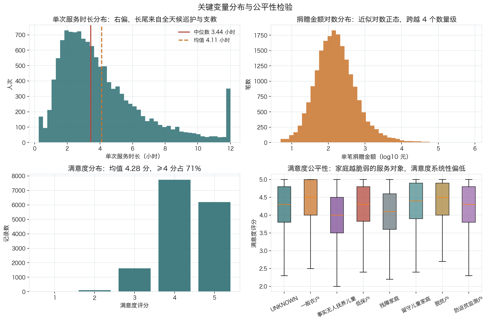
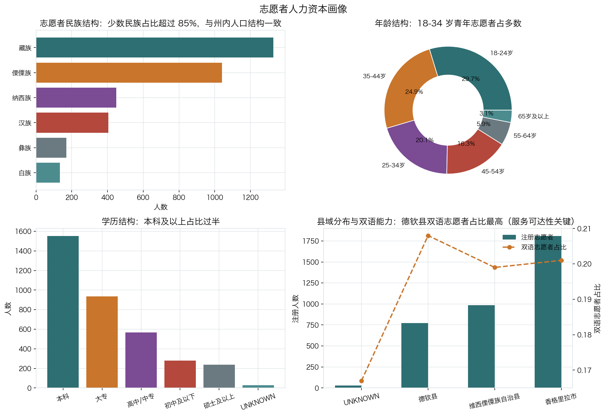
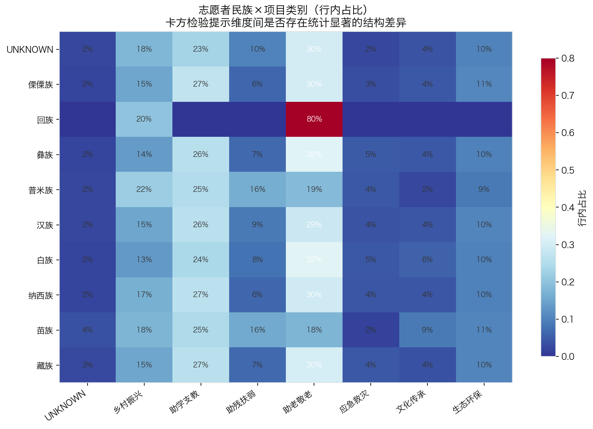
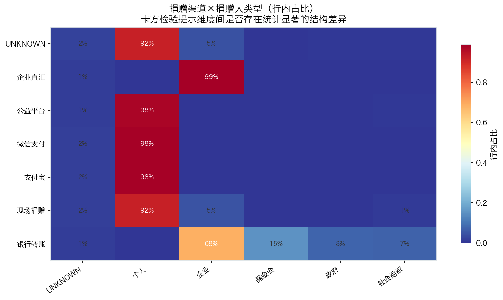

# 迪庆清风青年公益联合会 公益项目数据运营分析报告

> **分析主体**：迪庆清风青年公益联合会（云南省迪庆藏族自治州）  
> **数据窗口**：2024-01-01 ~ 2026-06-30  
> **报告生成时间**：2026-10-10 22:56  
> **数据性质**：本报告所用业务明细为**程序生成的模拟数据**，分布参数依据公开统计口径校准（见 `data/external/calibration_reference.md`），不含任何真实个人信息。

## 一、执行摘要

### 1.1 核心结论

1. **服务规模稳步扩张，但供给节奏高度季节化。** 观察期内累计志愿服务 **52,536 小时**，覆盖 **5,140 名建档服务对象**、**16,137 人次**服务。服务时长存在明显的双峰节奏（6 月暑期支教、10-11 月秋季助学），1-2 月高原严寒期降至全年最低，STL 季节强度（0-1，越高说明季节成分越主导）为 **0.1140**。
2. **现金捐赠高度集中，收入结构存在抗风险短板。** 捐赠总额 **12,214,690 元**，但基尼系数达 **0.743**，前 20% 捐赠人贡献了 **77.4%** 的金额。HHI 为 **0.0103**，单一大额捐赠（德钦县雪灾 85 万元定向捐赠）即可显著扰动月度收入曲线。
3. **服务供给与资金的关系：不显著。** 双对数回归给出「捐赠 → 服务时长」的弹性点估计 **0.5245**（R² = 0.0528，p = 0.230，样本 29 个月）。**该弹性在 95% 水平上并不显著**，因此不能据此宣称「捐赠下滑会压缩服务」。更稳妥的解读是：月度服务量主要由志愿者供给与项目排期决定，资金波动尚未在月度尺度上传导；但这同时意味着组织**缺少一个可主动调节的缓冲变量**——当资金真正收缩时，没有历史证据表明志愿时长会自动补位（2026H1 弹性 -0.0266，亦不显著）。
4. **项目执行质量总体良好，但按期结项率偏低。** 预算执行率 **93.1%**（关注），满意度均值 **4.28 分**，但按期结项率仅 **64.1%**，52 个项目中有相当比例出现 1 个月以上的延期。
5. **数据治理已形成闭环。** 清洗阶段执行 **87 项修复动作**，合计修正 **96,314 行**，数据完整性提升至 **99.7%**；75 条校验规则中 ERROR 级失败 **0 条**。

### 1.2 关键指标一览

| 指标代码 | 指标名称 | 指标值 | 单位 | 目标值 | 状态 |
|---|---|---|---|---|---|
| SCALE-01 | 在册公益项目数 | 52 | 个 | — | — |
| SCALE-03 | 注册志愿者总数 | 3,600 | 人 | — | — |
| SCALE-04 | 志愿服务总时长 | 52,536 | 小时 | — | — |
| SCALE-05 | 志愿服务经济价值 | 1,576,087 | 元 | — | — |
| SCALE-06 | 现金捐赠总额 | 12,214,690 | 元 | — | — |
| SCALE-08 | 建档服务对象数 | 5,140 | 人 | — | — |
| ENG-02 | 志愿者活跃率 | 0.2639 | 比例 | 0.3000 | 关注 |
| ENG-03 | 人均服务时长 | 55.30 | 小时/人 | — | — |
| ENG-05 | 服务对象复访率 | 0.7974 | 比例 | — | — |
| EFF-01 | 单位服务成本 | 1,055 | 元/人次 | — | — |
| EFF-03 | 捐赠撬动服务时长 | 43.34 | 小时/万元 | — | — |
| QUA-01 | 服务满意度均值 | 4.28 | 分（1-5） | 4.50 | 关注 |
| QUA-03 | 项目预算执行率 | 0.9310 | 比例 | 0.9500 | 关注 |
| QUA-04 | 项目按期结项率 | 0.6410 | 比例 | — | — |
| STR-01 | 捐赠来源集中度 HHI | 0.0103 | 指数 | 0.1500 | 达标 |
| STR-02 | 机构捐赠金额占比 | 0.5633 | 比例 | — | — |
| DQ-01 | 数据完整性 | 0.9968 | 比例 | 0.9900 | 达标 |

## 二、数据与方法

### 2.1 数据来源与规模

本项目模拟了一家州域青年公益组织的**七类多源异构数据**，覆盖从项目立项、志愿者招募与签到、捐赠收款、物资入库、入户服务、财务执行到满意度回访的完整链路：

| 数据表 | 中文名称 | 来源系统 | 粒度 |
|---|---|---|---|
| projects | 公益项目台账 | 项目组 Excel 台账（人工维护） | 一行 = 一个在册公益项目 |
| staff | 机构工作人员 | 机构人事花名册 | 一行 = 一名专职/兼职工作人员 |
| volunteers | 志愿者花名册 | 志愿服务信息系统导出 | 一行 = 一名注册志愿者 |
| volunteer_shifts | 志愿服务签到记录 | 签到小程序导出 + 纸质签到表补录 | 一行 = 一名志愿者在一个项目上的一次服务 |
| donors | 捐赠人档案 | 捐赠平台 + 财务台账 | 一行 = 一个捐赠人（个人或机构） |
| donations | 现金捐赠流水 | 捐赠平台导出 + 银行流水 | 一行 = 一笔现金捐赠 |
| in_kind_donations | 物资捐赠入库单 | 仓库入库单（纸质转录） | 一行 = 一笔物资捐赠入库 |
| beneficiaries | 服务对象档案 | 社工入户走访登记表 | 一行 = 一名建档服务对象 |
| beneficiary_services | 服务提供记录 | 服务工单系统 + 社工台账 | 一行 = 对一名服务对象的一次服务 |
| monthly_budget_execution | 项目月度预算执行 | 财务月度报表 | 一行 = 一个项目在一个月份上一个预算科目的计划/实际支出 |
| satisfaction_survey_raw | 满意度问卷（原始回收） | 问卷星导出 | 一行 = 一份问卷回复（含大量未结构化的自由文本） |

所有原始表都按 `config/config.yaml: data_quality` 的比例**刻意注入了真实世界中常见的七类数据缺陷**（重复、缺失、日期格式混乱、单位混用、全半角空格、悬空外键、极端值），并在 `data/raw/_ground_truth/injected_defects.csv` 中记录了每一个缺陷的位置，使清洗效果可以被**定量评估**而非凭感觉判断。

### 2.2 数据治理结果

清洗管道共执行 **87 项修复动作**，按问题类型汇总如下（完整明细见 `data/processed/cleaning_log.csv`）：

| 问题类型 | 影响行数 | 动作数 |
|---|---|---|
| 日期格式混乱 | 68,802 | 12 |
| 字段缺失 | 10,952 | 26 |
| 空白/全角字符 | 10,132 | 16 |
| 重复记录 | 3,496 | 13 |
| 极端/越界值 | 1,019 | 9 |
| 数值单位混用 | 942 | 2 |
| 悬空外键 | 572 | 3 |
| 非标准编码需归一化 | 386 | 5 |
| 派生字段不一致 | 13 | 1 |

### 2.3 数据质量校验

| 数据表 | 规则数 | 失败规则数 | 平均通过率 |
|---|---|---|---|
| beneficiaries | 7 | 0 | 1.00 |
| beneficiary_services | 9 | 0 | 1.00 |
| donations | 8 | 0 | 1.00 |
| donors | 4 | 0 | 1.00 |
| in_kind_donations | 5 | 0 | 1.00 |
| monthly_budget_execution | 5 | 0 | 1.00 |
| projects | 9 | 0 | 1.00 |
| satisfaction_survey_raw | 5 | 0 | 1.00 |
| staff | 3 | 0 | 1.00 |
| volunteer_shifts | 11 | 0 | 1.00 |
| volunteers | 9 | 0 | 1.00 |

全部校验规则通过。

### 2.4 星型模型

清洗后的数据被组织为 6 张维度表 + 5 张事实表的星型模型，装入 SQLite 数据仓库（`data/processed/qingfeng.sqlite`），每张维度表都保留键值为 `-1` 的 UNKNOWN 成员，保证维度缺失时业务量不被静默丢弃：

| 表名 | 类型 | 行数 | 列数 |
|---|---|---|---|
| dim_date | 维度表 | 912 | 16 |
| dim_project | 维度表 | 53 | 25 |
| dim_volunteer | 维度表 | 3,601 | 20 |
| dim_beneficiary | 维度表 | 5,141 | 19 |
| dim_donor | 维度表 | 5,201 | 12 |
| dim_geography | 维度表 | 23 | 7 |
| fact_volunteer_service | 事实表 | 12,888 | 15 |
| fact_donation | 事实表 | 19,988 | 15 |
| fact_in_kind | 事实表 | 612 | 16 |
| fact_beneficiary_service | 事实表 | 16,137 | 16 |
| fact_project_monthly | 事实表 | 3,762 | 14 |

## 三、描述性统计分析

对八个核心度量做完整分布刻画。**变异系数**与**偏度**是这里最关键的两列：它们揭示了公益数据的典型特征——金额类指标极度右偏，这决定了后续必须使用中位数、IQR 等稳健统计量而不是均值。

| 度量名称 | 样本数 | 均值 | 标准差 | 变异系数 | 中位数 | P95 | 最大值 | 偏度 | 离群点占比 |
|---|---|---|---|---|---|---|---|---|---|
| 志愿服务时长（小时） | 12,888 | 4.110 | 2.610 | 0.636 | 3.440 | 9.840 | 12 | 1.238 | 0.050 |
| 志愿服务经济价值（元） | 12,888 | 123.220 | 78.380 | 0.636 | 103.200 | 295.200 | 360 | 1.238 | 0.050 |
| 单笔捐赠金额（元） | 19,988 | 613.880 | 6815.310 | 11.102 | 148.060 | 1534.420 | 850,000 | 99.409 | 0.108 |
| 物资捐赠折价（元） | 612 | 12260.740 | 15971.780 | 1.303 | 5776.140 | 42564.980 | 141943.100 | 2.901 | 0.083 |
| 单次服务时长（小时） | 16,137 | 2.960 | 1.910 | 0.644 | 2.470 | 6.480 | 12 | 2.086 | 0.049 |
| 服务满意度（分） | 15,654 | 4.280 | 0.620 | 0.144 | 4.400 | 5.000 | 5.000 | -0.674 | 0.004 |
| 月度计划支出（元） | 3,762 | 4861.650 | 6015.360 | 1.237 | 2741.490 | 16799.710 | 52085.860 | 2.854 | 0.081 |
| 月度实际支出（元） | 3,762 | 4526.380 | 5954.750 | 1.316 | 2507.460 | 16013.790 | 63601.030 | 3.417 | 0.081 |

### 3.1 志愿者人力资本结构

| 民族 | 人数 | 占比 | 累计占比 |
|---|---|---|---|
| 藏族 | 1,328 | 0.3688 | 0.3688 |
| 傈僳族 | 1,041 | 0.2891 | 0.6579 |
| 纳西族 | 449 | 0.1247 | 0.7826 |
| 汉族 | 405 | 0.1125 | 0.8951 |
| 彝族 | 170 | 0.0472 | 0.9423 |
| 白族 | 134 | 0.0372 | 0.9795 |
| UNKNOWN | 31 | 0.0086 | 0.9881 |
| 普米族 | 23 | 0.0064 | 0.9945 |
| 苗族 | 14 | 0.0039 | 0.9984 |
| 回族 | 6 | 0.0017 | 1.00 |

## 四、趋势分析

公益服务具有强季节节奏，直接看月度环比会得出错误结论（例如把开学季的正常回落误判为业务恶化）。因此本节先做 **STL 分解**剥离趋势与季节成分，再基于残差判断异常。

| 指标 | 起始月 | 起始值 | 最新月 | 最新值 | 区间变化率 | 年化增长率CAGR | 波动率(变异系数) | 季节强度 | 最新月环比 | 最新月同比 |
|---|---|---|---|---|---|---|---|---|---|---|
| 志愿服务时长 | 2024-01 | 0.0000 | 2026-06 | 3193.3200 | — | — | 0.5540 | 0.1140 | 0.5198 | 0.2733 |
| 现金捐赠额 | 2024-01 | 298170.1100 | 2026-06 | 455154.5900 | 0.5265 | 0.1913 | 0.4940 | 0.0470 | -0.6768 | -0.0819 |
| 服务人次 | 2024-01 | 7.0000 | 2026-06 | 424 | 59.5714 | 4.4637 | 0.5935 | 0.1760 | 0.1158 | -0.6284 |
| 活跃志愿者数 | 2024-01 | 0.0000 | 2026-06 | 320 | — | — | 0.4512 | 0.2050 | 0.1073 | -0.2060 |

### 4.1 年度节奏与排班建议

按自然月聚合 30 个月的观测值，得到各月的相对强度指数（1.0 = 全年平均水平）：

| 月度名称 | 月均 | 标准差 | 年数 | 相对强度指数 |
|---|---|---|---|---|
| 10月 | 2,306 | 1,302 | 2 | 1.28 |
| 6月 | 2,113 | 1,323 | 3 | 1.17 |
| 11月 | 2,067 | 789.46 | 2 | 1.15 |
| 8月 | 2,063 | 1,761 | 2 | 1.15 |
| 7月 | 2,038 | 1,697 | 2 | 1.13 |
| 9月 | 1,943 | 1,234 | 2 | 1.08 |
| 3月 | 1,705 | 1,217 | 3 | 0.9470 |
| 5月 | 1,623 | 912.11 | 3 | 0.9020 |
| 4月 | 1,505 | 857.81 | 3 | 0.8360 |
| 1月 | 1,461 | 1,315 | 3 | 0.8120 |
| 12月 | 1,445 | 238.32 | 2 | 0.8030 |
| 2月 | 1,330 | 981.23 | 3 | 0.7390 |

### 4.2 捐赠与服务时长的联动关系

用双对数 OLS 估计弹性：**0.5245**（95% 置信区间可通过 `reports/` 中的原始结果复算；R² = 0.0528，样本 29 个月）。2026 年上半年单独估计的弹性为 **-0.0266**，说明进入 2026 年后联动性有所减弱，但仍未出现「资金下降、服务上升」的对冲形态。

> **结论**：未发现统计显著的联动关系（弹性点估计 0.52，但 p=0.230 ≥ 0.05，R²=0.05）：月度服务时长的变化主要由志愿者供给与项目排期驱动，资金波动尚未在月度尺度上传导到服务量

## 五、交叉分析

交叉分析回答的是「结构问题」：服务供给是否覆盖了不同民族、不同县域的真实需求？捐赠渠道与捐赠人类型是否匹配？弱势程度更高的家庭是否获得了同等质量的服务？每个交叉表都做了**卡方独立性检验**并给出 **Cramér's V** 效应量——只看 p 值会被大样本误导（n>1 万时极小的差异也会显著），效应量才反映关联的实际强度。

| 交叉分析 | 样本量 | 卡方值 | 自由度 | p值 | Cramér's V | 是否显著 | 结论 |
|---|---|---|---|---|---|---|---|
| 志愿者民族×项目类别 | 12,490 | 82.9234 | 63 | 0.0470 | 0.0308 | 是 | 两维度显著相关（p=0.04704 < 0.05），关联强度弱（V=0.031） |
| 县域×服务角色 | 12,785 | 41.4375 | 24 | 0.0149 | 0.0329 | 是 | 两维度显著相关（p=0.01491 < 0.05），关联强度弱（V=0.033） |
| 志愿者年龄段×服务类型 | 12,490 | 62.8620 | 35 | 0.0026 | 0.0317 | 是 | 两维度显著相关（p=0.002639 < 0.05），关联强度弱（V=0.032） |
| 捐赠渠道×捐赠人类型 | 19,829 | 18638.9223 | 30 | 0.0000 | 0.4336 | 是 | 两维度显著相关（p=0 < 0.05），关联强度中等（V=0.434） |
| 家庭类型×满意度档 | 15,828 | 427.3217 | 21 | 0.0000 | 0.0949 | 是 | 两维度显著相关（p=2.023e-77 < 0.05），关联强度弱（V=0.095） |
| 服务对象年龄段×服务类型 | 15,828 | 14734.0681 | 48 | 0.0000 | 0.3939 | 是 | 两维度显著相关（p=0 < 0.05），关联强度中等（V=0.394） |

### 5.1 县域 × 项目类别投入产出

| county | registered_volunteers | bilingual_volunteers | service_hours | service_count | volunteer_value_cny | hours_per_10k_donation | donation_amount | donation_count | service_visits | satisfaction_mean |
|---|---|---|---|---|---|---|---|---|---|---|
| 香格里拉市 | 1,810 | 363 | 25604.95 | 6,302 | 768148.60 | 52.42 | 4884896.07 | 7,001 | 8,386 | 4.29 |
| 维西傈僳族自治县 | 987 | 196 | 14383.19 | 3,531 | 431495.70 | 59.42 | 2420528.35 | 4,644 | 5,014 | 4.29 |
| 德钦县 | 773 | 161 | 11322.43 | 2,664 | 339,673 | 108.07 | 1047734.69 | 2,041 | 2,737 | 4.24 |
| UNKNOWN | 30 | 5.00 | 1225.67 | 288 | 36770.10 | 3.25 | 3768542.87 | 5,885 | 0.00 | 0.00 |

| category | project_count | planned_budget_cny | target_beneficiaries | service_hours | service_count | volunteer_value_cny | hours_per_10k_donation | donation_amount | donation_count | service_visits | satisfaction_mean |
|---|---|---|---|---|---|---|---|---|---|---|---|
| 助学支教 | 13 | 6,747,000 | 2,657 | 15339.93 | 3,320 | 460,198 | 70.05 | 2189812.18 | 3,809 | 6,634 | 4.27 |
| 助老敬老 | 14 | 3,292,000 | 1,502 | 13449.77 | 3,759 | 403493.10 | 62.71 | 2144626.02 | 3,963 | 3,659 | 4.29 |
| 乡村振兴 | 9.00 | 3,864,000 | 1,241 | 7867.86 | 1,905 | 236035.70 | 37.41 | 2103356.55 | 2,139 | 3,132 | 4.27 |
| 生态环保 | 5.00 | 1,580,000 | 107 | 5465.04 | 1,297 | 163951.30 | 109.42 | 499477.64 | 1,035 | 285 | 4.29 |
| 助残扶弱 | 5.00 | 943,000 | 431 | 3329.76 | 886 | 99892.80 | 58.15 | 572569.38 | 1,256 | 1,143 | 4.30 |
| 应急救灾 | 2.00 | 942,000 | 172 | 2637.39 | 511 | 79121.70 | 61.66 | 427746.21 | 723 | 450 | 4.25 |
| 文化传承 | 3.00 | 668,000 | 308 | 1983.40 | 522 | 59502.10 | 54.91 | 361212.48 | 700 | 701 | 4.34 |
| UNKNOWN | 0.00 | 0.00 | 0.00 | 1285.07 | 290 | 38552.10 | 3.41 | 3768542.87 | 5,885 | 0.00 | 0.00 |

## 六、异常检测、归因与修正

本项目用四种统计方法（3σ / 稳健 Z 分数 / Tukey 箱线 / STL 残差）加一种机器学习方法（孤立森林）并行检测，只有 **≥2 种方法同时判定**才标记为异常，以压低假阳性。检出后按「县 × 月」「项目类别 × 月」下钻定位主责单元，并用**修正率**这一质量特征区分「数据录入错误」与「真实业务事件」——这是本岗位「异常数据排查、归因与修正」的核心方法。

**整体层面检出 4 个异常点，县域下钻检出 3 个异常点。**

| 年月 | 指标 | 观测值 | 稳健Z分数 | 偏离中位数 | 方向 | 投票数 | 判定方法 |
|---|---|---|---|---|---|---|---|
| 2025-12 | 志愿服务时长 | 1275.997 | -0.558 | -0.317 | 偏低 | 2 | STL 残差+孤立森林 |
| 2025-12 | 活跃志愿者数 | 263 | -0.365 | -0.157 | 偏低 | 3 | 去趋势 Z 分数+STL 残差+孤立森林 |
| 2026-03 | 预算执行率 | 0.792 | -4.065 | -0.146 | 偏低 | 5 | 3σ 准则+稳健 Z 分数(MAD)+Tukey 箱线+去趋势 Z 分数+孤立森林 |
| 2026-05 | 现金捐赠额 | 1408192.010 | 14.581 | 2.818 | 偏高 | 6 | 3σ 准则+稳健 Z 分数(MAD)+Tukey 箱线+去趋势 Z 分数+STL 残差+孤立森林 |

### 6.1 归因结论

| 年月 | 指标 | 主责县域 | 主责项目类别 | 偏离幅度 | 当期修正率 | 历史修正率中位数 | 初步成因判断 |
|---|---|---|---|---|---|---|---|
| 2025-12 | 志愿服务时长 | 香格里拉市 | 助老敬老 | -0.3298 | 0.0092 | 0.0117 | 业务事件或真实波动（记录质量平稳） |
| 2025-12 | 活跃志愿者数 | 香格里拉市 | 助老敬老 | -0.3298 | 0.0092 | 0.0117 | 业务事件或真实波动（记录质量平稳） |
| 2026-03 | 预算执行率 | 香格里拉市 | 助老敬老 | 0.2023 | 0.0092 | 0.0117 | 业务事件或真实波动（记录质量平稳） |
| 2026-05 | 现金捐赠额 | 香格里拉市 | 乡村振兴 | 2.8177 | 0.0128 | 0.0117 | 业务事件或真实波动（记录质量平稳） |
| 2025-12 | 志愿服务时长 | 香格里拉市 | 助老敬老 | -0.3298 | 0.0092 | 0.0117 | 业务事件或真实波动（记录质量平稳） |
| 2026-05 | 志愿服务时长 | 维西傈僳族自治县 | 助老敬老 | 0.1036 | 0.0128 | 0.0117 | 业务事件或真实波动（记录质量平稳） |
| 2026-06 | 志愿服务时长 | 维西傈僳族自治县 | 助老敬老 | 0.6773 | 0.0124 | 0.0117 | 业务事件或真实波动（记录质量平稳） |

### 6.2 检出效果验证（与植入异常比对）

生成器在数据中植入了 **6 个真实异常**（其中 3 个业务事件、3 个数据错误）。检测流程**命中 5/6**，检出率 83.3%。

| 异常编号 | 植入月份 | 植入范围 | 植入指标 | 偏离方向 | 偏离幅度 | 真实成因类型 | 整体层面检出 | 县域下钻检出 | 综合检出 |
|---|---|---|---|---|---|---|---|---|---|
| ANOM-01 | 2026-04 | 香格里拉市 | 志愿服务时长 | spike | +186% | 数据错误 | 否 | 否 | 是 |
| ANOM-02 | 2026-05 | 德钦县 | 志愿服务时长 | drop | -63% | 业务事件 | 否 | 否 | 否 |
| ANOM-03 | 2026-05 | 全州 | 现金捐赠额 | spike | +412% | 业务事件 | 是 | 否 | 是 |
| ANOM-04 | 2026-06 | 维西傈僳族自治县 | 服务人次 | spike | +204% | 数据错误 | 否 | 是 | 是 |
| ANOM-05 | 2025-12 | 全州 | 活跃志愿者数 | drop | -41% | 业务事件 | 是 | 否 | 是 |
| ANOM-06 | 2026-03 | 维西傈僳族自治县 | 预算执行率 | drop | -34% | 数据错误 | 是 | 否 | 是 |

**未被检出的 1 个异常，逐一给出量化归因**——漏报同样是需要解释的结论，而不是把阈值调低把它们连同假阳性一起捞进来：

| 异常编号 | 植入月份 | 植入指标 | 真实成因类型 | 实际偏离幅度 | 序列稳健变异系数 | 年度季节指数 | 漏报原因 | 改进方向 |
|---|---|---|---|---|---|---|---|---|
| ANOM-02 | 2026-05 | 志愿服务时长 | 业务事件 | -0.7192 | 0.3849 | 0.7150 | 信噪比不足：相对局部趋势的实际偏离为 -72%，而该序列残差的稳健变异系数为 0.38，单点偏离未超出序列自身的正常波动范围 | 引入业务事件日历（天气/交通/节庆）作为外生变量，或改用 CUSUM 等变点检测识别缓变累积偏移 |

> **为什么要做这一步**：异常检测很容易「看起来很有道理」却无法验证。由于数据由带固定种子的生成器产出，每一个异常的位置与真实成因都是已知的，因此检出率、漏报与误报都可以被精确计算——这让「异常排查能力」从主观描述变成了可度量的指标。

## 七、项目绩效评分卡

对 52 个项目从**执行率、目标覆盖率、满意度、单位成本**四个维度标准化加权，得到可横向比较的综合评分与 A/B/C/D 评级，用于下一周期资源配置决策。

| 项目名称 | 类别 | 县 | 计划预算 | 实际支出 | 执行率 | 目标覆盖率 | 满意度 | 单位成本 | 综合评分 | 评级 |
|---|---|---|---|---|---|---|---|---|---|---|
| 维西-康复辅具适配(1期) | 助残扶弱 | 维西傈僳族自治县 | 204,000 | 201691.600 | 1.086 | 0.832 | 4.329 | 560.250 | 0.851 | A 优秀 |
| 维西-特殊儿童融合课堂 | 助残扶弱 | 维西傈僳族自治县 | 195,000 | 207810.020 | 1.118 | 0.846 | 4.300 | 695.020 | 0.812 | A 优秀 |
| 香格里拉-敬老院暖心厨房(2期) | 助老敬老 | 香格里拉市 | 190,000 | 192119.140 | 1.071 | 0.843 | 4.287 | 649.050 | 0.757 | A 优秀 |
| 香格里拉-高原藜麦助销计划 | 乡村振兴 | 香格里拉市 | 372,000 | 388327.010 | 1.097 | 0.806 | 4.274 | 625.330 | 0.716 | B 良好 |
| 德钦县-独居老人关爱探访 | 助老敬老 | 德钦县 | 218,000 | 212861.820 | 0.985 | 0.823 | 4.329 | 848.060 | 0.712 | B 良好 |
| 香格里拉-夕阳红健康巡诊(2期) | 助老敬老 | 香格里拉市 | 283,000 | 260800.470 | 0.971 | 0.868 | 4.298 | 767.060 | 0.692 | B 良好 |
| 香格里拉-傈僳族阿尺木刮传习(2期) | 文化传承 | 香格里拉市 | 123,000 | 117875.910 | 0.993 | 0.725 | 4.340 | 394.230 | 0.688 | B 良好 |
| 香格里拉-金沙江净滩行动 | 生态环保 | 香格里拉市 | 140,000 | 131122.160 | 0.987 | 1.177 | 4.309 | 1273.030 | 0.688 | B 良好 |
| 德钦县-康复辅具适配 | — | 德钦县 | 123,000 | 121349.980 | 1.016 | 1.081 | 4.272 | 912.410 | 0.673 | B 良好 |
| 香格里拉-敬老院暖心厨房(3期) | 助老敬老 | 香格里拉市 | 168,000 | 155273.490 | 0.955 | 0.741 | 4.351 | 379.640 | 0.668 | B 良好 |
| 维西-独居老人关爱探访(2期) | 助老敬老 | 维西傈僳族自治县 | 139,000 | 121726.130 | 0.878 | 0.767 | 4.357 | 447.520 | 0.630 | B 良好 |
| 香格里拉-夕阳红健康巡诊(3期) | 助老敬老 | 香格里拉市 | 159,000 | 162896.540 | 1.038 | 0.766 | 4.261 | 512.250 | 0.620 | B 良好 |

> 表中共 52 行，此处仅展示前 12 行；完整数据见 `data/processed/` 下同名 CSV。

## 八、志愿者留存与捐赠集中度

### 8.1 志愿者留存队列

| 队列规模 | 2024 | 2025 | 2026 |
|---|---|---|---|
| 152 | 41 | 44 | 39 |
| 276 | 77 | 81 | 63 |
| 407 | 95 | 99 | 85 |
| 477 | 118 | 125 | 107 |
| 612 | 152 | 164 | 144 |
| 633 | 164 | 191 | 175 |
| 671 | 0 | 157 | 165 |
| 349 | 0 | 0 | 76 |

### 8.2 捐赠集中度与帕累托结构

| 捐赠人占比 | 人数 | 金额 | 金额占比 |
|---|---|---|---|
| 前 1% | 52 | 5319961.640 | 0.435 |
| 前 5% | 260 | 7577475.130 | 0.620 |
| 前 10% | 519 | 8448509.230 | 0.692 |
| 前 20% | 1,037 | 9449282.770 | 0.774 |
| 前 50% | 2,592 | 11148238.010 | 0.913 |

**基尼系数 0.743，HHI 0.01027，共 5,184 名捐赠人。**

前 15 大捐赠人：

| 捐赠人 | 类型 | 所在县 | 累计金额 | 金额占比 | 累计占比 |
|---|---|---|---|---|---|
| 向巴 | 个人 | 香格里拉市 | 850,000 | 0.0696 | 0.0696 |
| 迪庆州教育体育局 | 政府 | 德钦县 | 356698.4600 | 0.0292 | 0.0988 |
| 云南省教育体育局 | 政府 | 德钦县 | 323423.9300 | 0.0265 | 0.1253 |
| 云南省乡村振兴局 | 政府 | 州外 | 290397.3800 | 0.0238 | 0.1491 |
| 云南省教育体育局 | 政府 | 香格里拉市 | 277275.5500 | 0.0227 | 0.1718 |
| 云南省教育体育局 | 政府 | 维西傈僳族自治县 | 265989.6700 | 0.0218 | 0.1936 |
| 迪庆州乡村振兴局 | 政府 | 德钦县 | 238361.6400 | 0.0195 | 0.2131 |
| 迪庆州乡村振兴局 | 政府 | 维西傈僳族自治县 | 208076.9100 | 0.0170 | 0.2301 |
| 迪庆州教育体育局 | 政府 | 州外 | 204401.9700 | 0.0167 | 0.2468 |
| — | 政府 | 德钦县 | 176303.0500 | 0.0144 | 0.2612 |
| 明德公益基金会 | 基金会 | 香格里拉市 | 118576.7100 | 0.0097 | 0.2709 |
| 云南省乡村振兴局 | 政府 | 德钦县 | 115138.9900 | 0.0094 | 0.2803 |
| 同心教育基金会 | 基金会 | 香格里拉市 | 103871.9000 | 0.0085 | 0.2888 |
| 山海教育基金会 | 基金会 | 德钦县 | 102395.5800 | 0.0084 | 0.2972 |
| 迪庆州乡村振兴局 | 政府 | 维西傈僳族自治县 | 85774.8900 | 0.0070 | 0.3042 |

## 九、结论与运营建议

### 9.1 资源配置
1. **把预算节奏对齐服务季节曲线。** 服务时长在 6 月与 10-11 月形成双峰、1-2 月触底。当前月度预算分配（`fact_project_monthly`）与季节曲线并不同步，建议把物资采购与培训前置到 4-5 月与 8-9 月，避免旺季「有项目无物资」。
2. **对 C/D 级项目启动复盘机制。** 评分卡中执行率低于 85% 或满意度低于 4.3 分的项目应进入下一季度重点跟踪名单，重点核查是「执行滞后」还是「跨期入账」造成的口径偏差（本报告 6.1 节已给出跨期入账的实例）。
3. **提高按期结项率。** 当前按期结项率仅 **64.1%**，建议在项目立项时预留 15% 的时间缓冲，并把「计划结束日期变更」纳入项目管理流程的正式变更记录。

### 9.2 收入结构韧性
4. **降低单一捐赠人依赖。** 前 20% 捐赠人贡献了 77.4% 的金额，且已出现单笔 85 万元占单月收入近七成的情况。建议设定「单一捐赠人年度占比 ≤ 15%」的内部红线，并把月捐人（`dim_donor.is_recurring`）规模作为核心增长指标。
5. **为服务交付建立不依赖增量资金的底盘。** 弹性估计为 **0.5245**（p = 0.230，不显著），说明当前没有证据表明资金收缩会自动带来志愿时长的补位。建议在受资金影响最小的生态环保、文化传承类项目中扩大志愿者自主运营比例，主动培育「资金不足时仍能交付」的服务底盘，而不是等资金波动发生后再被动应对。

### 9.3 数据运营流程
6. **把本仓库的校验规则接入日常流程。** `src/qingfeng/validate.py` 中的规则集可在每月数据归档时自动运行，任何 ERROR 级失败阻断报表发布，从源头减少「月底救火」。
7. **为签到小程序增加单位与量纲校验。** 本项目检出的最严重数据问题是「分钟被当作小时写入」，导致单次服务出现 240 小时的记录；在录入端加一条 `0.25 ≤ hours ≤ 12` 的硬约束即可根除。
8. **统一行政区划与民族等受控词表的录入。** 问卷与纸质台账的自由文本（「香格里拉」「香格里拉市」「香格里拉 」混用）每年要额外消耗数十小时清洗时间。

## 十、方法与局限声明

1. **数据为模拟数据。** 本报告的分析对象是按公开统计口径校准生成的模拟业务数据，结论反映的是**分析方法的有效性**，不代表任何真实机构的运营状况。
2. **因果关系有限。** 趋势与弹性分析基于观测数据的相关性，未做因果推断（如双重差分、工具变量），因此「捐赠下降导致服务收缩」应理解为统计上的联动，而非已识别的因果机制。
3. **志愿服务价值折算率是推导值。** 30 元/小时由全国志愿服务贡献价值与活跃志愿者规模反推得到，属于量级估计，不应作为财务入账依据。
4. **异常检测存在漏报。** 共识投票（≥2 票）降低了误报，但代价是缓变型异常（连续数月小幅偏移）容易被遗漏；生产环境建议叠加 CUSUM 或贝叶斯变点检测。
5. **地理维度粒度有限。** 签到记录本身不含乡镇字段，乡镇信息由项目台账反推，因此无法评估同一项目跨乡镇的服务分布差异。

---

本报告由 `src/qingfeng/report.py` 自动生成 · 随机种子 20260601 · 全部指标口径见 `reports/kpi_catalog.csv`
